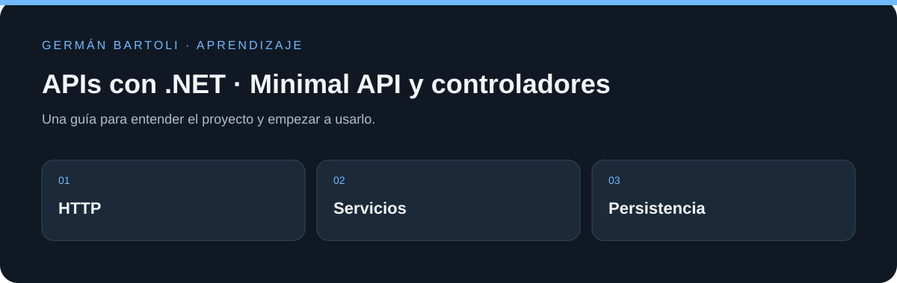

# APIs con .NET · Minimal API y controladores

**Ejemplos de API con .NET: una Minimal API y un proyecto con controladores, servicios, middleware, tareas y categorías.**

[Empezar](#primeros-pasos) · [Mapa del repositorio](#mapa-del-repositorio) · [Autoría](#autoría-de-esta-documentación)

*Esquema de orientación; no representa una captura de la aplicación.*

## Primeros pasos

1. Compará `minimalapi/Program.cs` con `webapi/Program.cs`.
2. Revisá los controladores y servicios de `webapi/` y prepará una base local si vas a usar sus operaciones persistentes.
3. Ambos proyectos declaran `net7.0`; ejecutá uno por vez y consultá la dirección local indicada por la aplicación.

## Entorno de aprendizaje

Este repositorio conserva ejercicios y versiones de su etapa de estudio. Revisá los archivos de proyecto para preparar el SDK, runtime o servidor correspondiente; esta actualización del README no migra dependencias ni acredita una ejecución reciente de todos los ejemplos.

## Referencia y detalles

https://platzi.com/cursos/apis-net/
https://github.com/platzi/curso-apis-net/tree/13-conectandodb

## Mapa del repositorio

- [minimalapi/minimalapi.csproj](<minimalapi/minimalapi.csproj>)
- [minimalapi/minimalapi.sln](<minimalapi/minimalapi.sln>)
- [webapi/webapi.csproj](<webapi/webapi.csproj>)
- [minimalapi/Program.cs](<minimalapi/Program.cs>)
- [webapi/Program.cs](<webapi/Program.cs>)

## Autoría de esta documentación

Repositorio mantenido por [Germán Bartoli](https://github.com/GermanBartoli). Guía revisada y actualizada con **Codex**, coautor de esta actualización documental. Los autores, colaboradores, licencias y recursos de terceros conservan sus créditos originales.

Los commits de esta revisión incluyen `Co-authored-by: Codex <noreply@openai.com>`; esta atribución no modifica la autoría del historial anterior.

<!-- firma-german-bartoli -->

  <a href="https://germanbartoli.pages.dev/">
     
    Hecho por Germán Bartoli · Ver portfolio
  </a>

